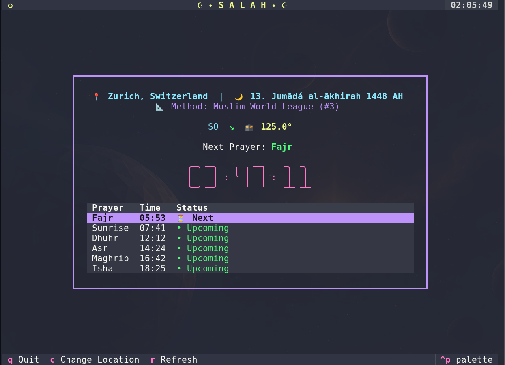

# 🕌 Salah

A sleek terminal user interface (TUI) for Islamic prayer times built with [Textual](https://textualize.io) and styled in the **Dracula** theme.



## ✨ Features

- **Live Countdown** to the next upcoming prayer
- **Color-Coded Status** (`Gold` for passed prayers, `Green` for next & upcoming prayers)
- **Qibla Direction** shown as a compass rose with the bearing in degrees
- **Hijri & Gregorian Date** display
- **Interactive Settings Modal** to switch city, country, and calculation method on the fly
- **Calculation Method Indicator** showing the active method fetched from the [AlAdhan API](https://aladhan.com)

## 📦 Installation

Install globally in an isolated environment using [pipx](https://pypa.io):

```bash
pipx install git+https://github.com/postsonde/salah-tui.git
```

## 🚀 Usage

Launch the application from anywhere in your terminal:

```bash
salah
```

### Keyboard Shortcuts

| Key | Action |
| :--- | :--- |
| `c` | Change city, country, and calculation method |
| `r` | Refresh prayer times |
| `q` | Quit the application |

## 🕋 Qibla Direction

The Qibla is the direction from your location to the Kaaba in Makkah. Salah shows it as a compass rose between the calculation method and the next prayer. The arrow points in the Qibla direction, and the line below shows the compass point and the exact bearing in degrees.

### How It Is Calculated

- **Coordinates:** The city and country are geocoded with the [Open-Meteo Geocoding API](https://open-meteo.com/en/docs/geocoding-api). Results are cached per city for the current session.
- **Bearing:** The initial great-circle bearing from your coordinates to the Kaaba (21.4225° N, 39.8262° E) is computed with spherical trigonometry. The result is measured in degrees clockwise from true north (0° = N, 90° = E, 180° = S, 270° = W).
- **Independence:** The Qibla is calculated locally and does not depend on the selected calculation method for prayer times.

### ⚠️ Notes and Limitations

- **City-level accuracy:** The bearing is computed from the city centre, not your exact position. For distant cities, the difference to your actual location is usually small, but it can be a degree or more in some cases.
- **True north, not magnetic north:** The bearing refers to geographic north. A magnetic compass shows a different value, depending on your location and the current magnetic declination. Use a compass app or a map with a correction if you need the magnetic bearing.
- **Ambiguous city names:** The geocoder prefers the country you entered, but common city names can still match the wrong place. Check the displayed location and the Qibla value if something looks wrong. You can verify the result with the [AlAdhan Qibla endpoint](https://aladhan.com/qibla-api) by passing the coordinates.
- **Internet required:** Prayer times and the first Qibla lookup for a city need an internet connection. Cached cities are available for the rest of the session.
- **Not verified in the field:** The calculation has been checked against reference values, but it has not been tested on site. For prayer, rely on local mosques and authorities where possible.

## ⚙️ Supported Calculation Methods

- **3** – Muslim World League *(default)*
- **13** – Diyanet İşleri Başkanlığı, Turkey
- **2** – Islamic Society of North America (ISNA)
- **4** – Umm Al-Qura University, Makkah
- **5** – Egyptian General Authority of Survey
- **1** – University of Islamic Sciences, Karachi
- **12** – Union Organization Islamic de France
- **15** – Moonsighting Committee Worldwide

## 📄 License

GNU General Public License (GPLv3)
